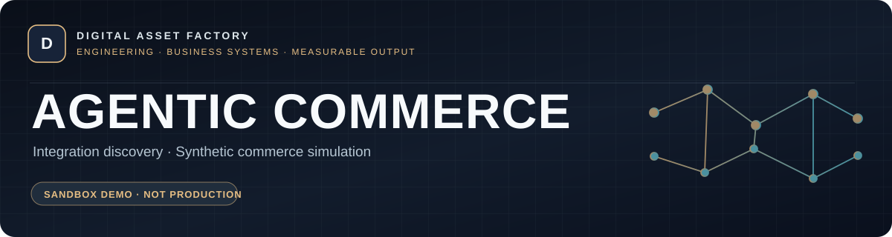

# Agentic Commerce · Integration Layer
**Explore merchant integration feasibility before commissioning a production connector.**

[**Try synthetic sandbox**](https://agentic-commerce-public-sandbox.netlify.app/) · [**Demo guide**](docs/DEMO_GUIDE.md) · [**Buyer checklist**](docs/BUYER_DUE_DILIGENCE.md) · [**Commercial options**](docs/COMMERCIAL_OPTIONS.md) · [**Contact privately**](mailto:agenticcommerce975@gmail.com?subject=Agentic%20Commerce%20Inquiry) · [**Русский**](#по-русски)

> **Technology status:** Engineering prototype with a simulated public sandbox. No live merchant integration, autonomous buyer, payment operation, protocol certification or verified commercial deployment.

| Audience | What the preview demonstrates | What it does not demonstrate |
| :--- | :--- | :--- |
| Merchant technology teams, integrators and platform architects | Synthetic catalog, inventory and simulated order workflows; concrete discovery questions | Live checkout, merchant ERP connections, production service levels or approved industry-standard compliance |

**Start with a concrete use case.** We first review the merchant stack, existing native alternatives, integration constraints and acceptance checks. A paid assessment or pilot requires a separate feasibility review and agreed scope.

**Related engineering work:** [Lead Leakage Auditor — CRM diagnostics](https://github.com/alexgeractor-web/lead-leakage-auditor-showcase) · [Digital Asset Factory portfolio](https://github.com/alexgeractor-web/lead-leakage-auditor-showcase/blob/main/docs/GITHUB-PROFILE-README.md)

---

## The integration problem

AI-assisted commerce may require a bridge between an existing merchant stack and emerging agent-facing catalog, stock, ordering and checkout workflows. Custom / legacy commerce platforms often differ in their product feeds, inventory semantics, security models, order states and ERP/WMS dependencies.

**Our commercial approach:** examine a concrete integration need, identify gaps and blockers, validate one limited scenario, and agree measurable acceptance criteria before any expanded implementation. Existing native plugins may be preferable where they solve a buyer's needs.

## What visitors can examine

| Public item | What it shows | What it does **not** establish |
| --- | --- | --- |
| [Hosted sandbox](https://agentic-commerce-public-sandbox.netlify.app/) | Synthetic product catalog, per-visitor demo inventory and simulated order events | Actual AI buyer, live ERP/CMS merchant connector, real payments, certified UCP/ACP/MCP conformance, or production-grade shared order processing |
| [Commercial options](docs/COMMERCIAL_OPTIONS.md) | Indicative feasibility, PoC, pilot and licensing pathways | A guaranteed quote or agreed production commitment |
| [Buyer checklist](docs/BUYER_DUE_DILIGENCE.md) | Information needed to scope the client's environment | Access to proprietary code or production secrets |

**Important:** the hosted sandbox is a non-production simulation with test goods and figures. Do not enter personal customer data, live credentials or payment details. Demo session metrics are not actual business revenue.

## Engagement options

| Format | Indicative starting budget |
| --- | ---: |
| Integration Fit Assessment | **from 39,000 RUB** |
| Paid Proof of Concept (PoC) | **from 149,000 RUB** |
| Scoped Integration Pilot | **provisionally from 490,000 RUB**, only after feasibility confirmation |
| White-label / License / Acquisition | **Negotiated individually** |

Prices are nonbinding starting estimates, **not a public offer**, verified market valuation or guarantee that a particular integration is deliverable. Exact scope, costs, schedule, taxes, acceptance tests, support terms and IP rights require a separate agreement. See [full details](docs/COMMERCIAL_OPTIONS.md).

## For prospective buyers and integrators

1. Try the [sandbox](https://agentic-commerce-public-sandbox.netlify.app/) and consult the [demonstration guide](docs/DEMO_GUIDE.md).
2. Use the [discovery checklist](docs/BUYER_DUE_DILIGENCE.md) to frame your use case.
3. For a **non-confidential public question**, [create an Issue](https://github.com/alexgeractor-web/agentic-commerce-public-show-case/issues/new?template=general-question.yml). All GitHub Issues are publicly visible.
4. For a **private commercial inquiry**, email **agenticcommerce975@gmail.com**. Initially send only high-level facts — not API keys, payment data or confidential architecture.
5. Source-code access, buyer due diligence, licensing and any development contract are negotiated separately.

No current claim is made of live customer adoption, production readiness, independent security certification or real transaction volume. Any post-delivery defect correction, support, data use, monitoring and documentation must be specified in a written statement of work.

**Security issues:** please read [SECURITY.md](SECURITY.md).

---

## По-русски

Agentic Commerce — **публичная презентация направления интеграции систем электронной коммерции с агентными сценариями**. Этот открытый репозиторий содержит **только ознакомительные материалы**, а не коммерческое исходное ядро.

[Демо](https://agentic-commerce-public-sandbox.netlify.app/) демонстрирует исключительно **тестовые товары, остатки и заказы**, а не реальную торговлю, оплату или работу автономного AI-покупателя.

**Предварительные бюджеты:** техническая оценка — от **39 000 ₽**, проверка концепции (PoC) — от **149 000 ₽**, пилотная интеграция — ориентировочно от **490 000 ₽** после проверки реализуемости; лицензия и приобретение программного актива — по договорённости. Это **не публичная оферта**.

**Вопросы:** [GitHub Issues](https://github.com/alexgeractor-web/agentic-commerce-public-show-case/issues/new?template=general-question.yml) — только для публичной информации. **Коммерческие запросы:** [agenticcommerce975@gmail.com](mailto:agenticcommerce975@gmail.com). Не публикуйте логины, API-ключи, клиентские данные и конфиденциальные материалы.

© 2026. All rights reserved. See [LICENSE](LICENSE).
